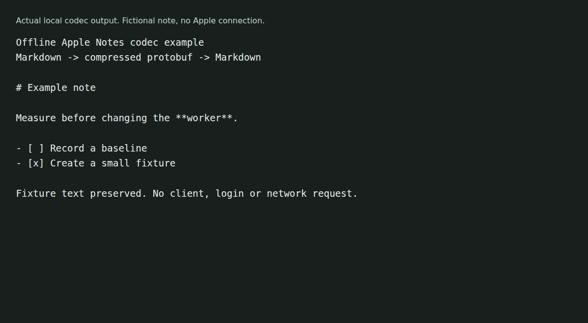

# icloud-cli

An unofficial Rust client for iCloud Notes, Reminders and Hide My Email, with an embedded shell over a virtual filesystem. It uses Apple's private web endpoints, which can change without notice.



The example exercises the project's Markdown and compressed protobuf codec. It does not log in, contact Apple or prove live sync compatibility. [Capture details](docs/demo/README.md).

## Try the note codec without an account

Use Rust with Cargo and Git. The workspace selects the stable toolchain and fetches a pinned Bashbox dependency.

```sh
git clone https://github.com/olegpustovit/icloud-cli.git
cd icloud-cli
cargo run --locked -p icloud-api --example offline_note
```

This converts a fictional note from Markdown to the internal compressed protobuf representation and back. It checks that the example text survives. It creates no session or API client.

## Build the CLI

```sh
cargo build --locked -p icloud-cli
./target/debug/icloud --help
```

The binary is named `icloud`. To install it from this checkout:

```sh
cargo install --locked --path crates/icloud-cli
```

The code exposes Notes, Reminders, Hide My Email, search, copy and shell commands. The checked-in implementation includes Notes editing and codecs, rather than only metadata listing. Source presence does not establish current compatibility with Apple's services.

## Connect an account deliberately

Read [account commands and development](docs/reference.md) before signing in. `icloud login --help` describes the login flags. Keep passwords out of shell history and treat session files, cookies, tokens and cached note content as sensitive.

Account commands may contact Apple even when they read a local cache. The global `--max-age` defaults to five seconds; it controls cache freshness, not a guaranteed offline mode. Shell and copy commands can write or delete account data. No live account operation was performed for this documentation capture.

## Status and checks

The [capture notes](docs/demo/README.md) record the build environment, exact commands and bounded results. Notes codec tests use fictional input. Live authentication, sync, mutations, attachment handling, shell writes and cross-platform compatibility need separate checks.

The release workflow targets Linux and macOS. Windows release artifacts are not supported. The toolchain file selects `stable`; it does not pin an exact compiler release.

## More detail

- [Account and development reference](docs/reference.md)
- [Progress and unresolved behavior](PROGRESS.md)
- [Development rules](AGENTS.md)
- [Protocol references](references/README.md)
- [MIT license](LICENSE)
